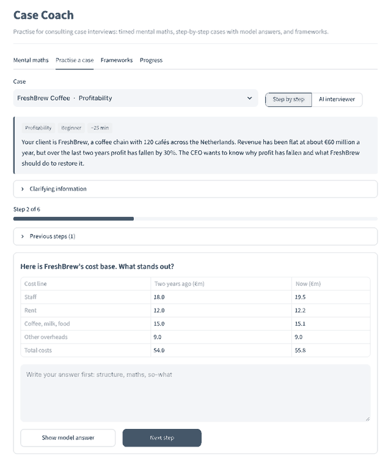

# Case Coach

A practice tool for consulting case interviews: timed mental maths, step-by-step cases with model answers, and a frameworks sheet.

I built it to prepare for strategy consulting interviews, because the two things that improve fastest with daily practice are case maths and structured thinking. Author: [Aafan Khan](https://www.linkedin.com/in/aafan-khan).



## What it does

1. **Mental maths drills** in seven types common in cases: percentages, % change, multiplication, revenue, breakeven, growth (rule of 72) and market share. Each answer is timed and checked, with a tip for the quick method. Answers like `15%`, `1,400` or `1.4k` are all accepted.
2. **Step-by-step cases.** Read the prompt, reveal clarifying information, then work through each step (structure, exhibits, maths, brainstorm, recommendation). Write your answer first, then compare it with the model answer.

   | Case | Type | Level |
   |---|---|---|
   | FreshBrew Coffee | Profitability | Beginner |
   | VeloNova enters Germany | Market entry | Intermediate |
   | Coffees sold in Amsterdam | Market sizing | Beginner |
   | Lumo oat drink launch | Pricing and breakeven | Intermediate |

3. **AI interviewer (optional).** With an Anthropic API key, Claude plays the interviewer for the selected case: it shares data only when asked, pushes back on vague structures and scores your performance at the end.
4. **Frameworks** for profitability, market entry, market sizing, pricing, M&A and recommendations.
5. **Progress tracking:** log each case with a score and one lesson, see your scores over time and download the log as a CSV.

## Run it

```bash
pip install -r requirements.txt
streamlit run app.py
```

Optional AI interviewer: copy `.streamlit/secrets.toml.example` to `.streamlit/secrets.toml` and add your `ANTHROPIC_API_KEY`.

## Project structure

```
app.py                Streamlit interface
casecoach/drills.py   Maths drill generators, answer parsing and checking
casecoach/cases.py    Practice cases and frameworks
casecoach/coach.py    Optional Claude interviewer
tests/                Unit tests (pytest)
```

## Tests

```bash
pytest -q
```

## Note

All cases, companies and figures are fictional and written for practice. Market sizing answers are one reasonable estimate, not facts.

## License

MIT
